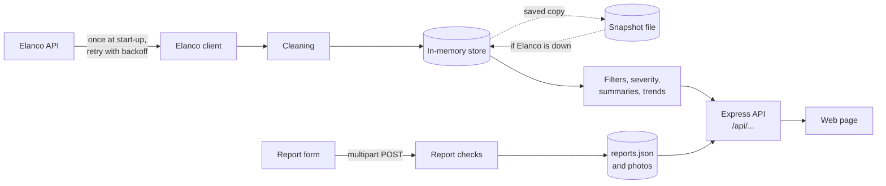

# Tick Tracker

**UK tick sightings: a full-stack technical task for the Elanco IT Industrial Placement 2027/28.**

By **Hibatallah Maatallah**, BEng (Hons) Software Engineering, Liverpool John Moores University.

Tick Tracker turns Elanco's tick sightings data into a map, charts and practical guidance, and lets
anyone report a sighting of their own. An Express API fetches Elanco's data once, cleans it, works
out how active each city is, and serves everything the page needs. The page is plain HTML, CSS and
JavaScript with Leaflet, Chart.js and Tailwind.

## Contents

- [What it does](#what-it-does)
- [Run it](#run-it)
- [Check it](#check-it)
- [How it works](#how-it-works)
- [Technical choices](#technical-choices)
- [Data handling](#data-handling)
- [Severity](#severity)
- [Error handling](#error-handling)
- [Accessibility](#accessibility)
- [Security and privacy](#security-and-privacy)
- [API](#api)
- [Project structure](#project-structure)
- [How I used AI](#how-i-used-ai)
- [What I would do differently with more time](#what-i-would-do-differently-with-more-time)
- [Credits](#credits)

Further documents: [architecture](docs/architecture.md), [API reference](docs/api.md),
[wireframes](docs/wireframes/README.md) and the [video walkthrough outline](docs/video-walkthrough.md).

## What it does

Every item in the brief is built, for the full-stack variant.

### Frontend

| Area                    | Feature                                                                                                                                                                                                   |
| ----------------------- | --------------------------------------------------------------------------------------------------------------------------------------------------------------------------------------------------------- |
| **Interactive map**     | A Leaflet map of the UK with one marker per city                                                                                                                                                          |
|                         | Markers show **severity** (fill colour), **recent activity** (a ring for a sighting in the last 30 days of the data), **species** (a letter for the most-seen species) and the number of sightings (size) |
|                         | **Filters** for date range (with quick ranges), species and severity, kept in the address bar so a link reopens the same view                                                                             |
| **Sighting details**    | A **detail panel** opens when a marker or list row is chosen                                                                                                                                              |
|                         | A **timeline** chart of sightings per year in that city, plus its species mix and latest sightings                                                                                                        |
|                         | **Quick actions**: report a sighting here, get directions, share                                                                                                                                          |
| **Educational content** | A **species identification guide** built from the five species in the data, each with an original drawing                                                                                                 |
|                         | **Prevention tips** as a numbered checklist, based on NHS and UK Health Security Agency guidance                                                                                                          |
|                         | A **seasonal activity chart** with city and year dropdowns, and an honest verdict on whether there is a seasonal pattern at all                                                                           |
| **Report a sighting**   | A form for date, time, city, species and notes                                                                                                                                                            |
|                         | **Validation** with distinct error (red), warning (amber) and success (green) messages                                                                                                                    |
|                         | **Photo upload**, cleaned in the browser before it is sent                                                                                                                                                |

There is also a city list beside the map (the same information without a map), trend and per-region
charts that follow the filters, a data-quality report and a plain-English explanation of the
severity rule.

### Backend

| Area               | What the API does                                                                                                                                                                                                       |
| ------------------ | ----------------------------------------------------------------------------------------------------------------------------------------------------------------------------------------------------------------------- |
| **Data handling**  | Fetches Elanco's data once at start-up with timeouts, retries and backoff; cleans it (duplicates, missing fields, bad dates, letter case, unknown values) and keeps it in memory, with a snapshot on disk as a fallback |
| **API endpoints**  | Accepts new sighting reports with a photo; searches and filters sightings by time range, location, species and severity; aggregates per city, per UK region and per species, and over time (weekly, monthly or yearly)  |
| **Error handling** | Handles Elanco being slow, rate limiting, down or returning bad data; inconsistent records; and invalid submissions, each with a clear status code and message                                                          |

## Run it

You need [Node.js](https://nodejs.org/) 22 or later.

```bash
git clone https://github.com/hiba3107/elanco-placement.git
```

```bash
cd elanco-placement
```

```bash
npm install
```

```bash
npm start
```

Then open <http://localhost:3000>. The server answers straight away and loads Elanco's data in the
background; the page shows "Loading tick data from Elanco…" for a moment and then fills in by
itself. For development, `npm run dev` restarts the server whenever a file changes.

The first successful fetch saves a copy of Elanco's data to `api/data/elanco-snapshot.json`. If
Elanco's API is down the next time the server starts, Tick Tracker shows that saved copy and says so,
so a demo still works without the live API.

> **OneDrive:** keeping the project inside a OneDrive folder can make `npm install` slow and can
> briefly lock the files the server writes. The server retries locked writes, but if you see errors,
> move the folder outside OneDrive or set `DATA_DIR` to a folder that is not synced.

### Settings

All settings are optional environment variables, checked when the server starts.

| Variable                     | Default                                               | What it controls                                           |
| ---------------------------- | ----------------------------------------------------- | ---------------------------------------------------------- |
| `PORT`                       | `3000`                                                | The port the server listens on                             |
| `ELANCO_API_URL`             | `https://dev-task.elancoapps.com/data/tick-sightings` | Where the sightings come from                              |
| `ELANCO_TIMEOUT_MS`          | `10000`                                               | How long to wait for Elanco before giving up on an attempt |
| `ELANCO_MAX_ATTEMPTS`        | `5`                                                   | Attempts per fetch, with exponential backoff between them  |
| `ELANCO_REFRESH_MINUTES`     | `360`                                                 | How often to refresh the data (0 turns refreshing off)     |
| `ELANCO_RECOVERY_MINUTES`    | `2`                                                   | How often to retry while Elanco is unreachable             |
| `REPORT_RATE_LIMIT`          | `10`                                                  | Reports each visitor may send per window                   |
| `REPORT_RATE_WINDOW_MINUTES` | `15`                                                  | The length of that window                                  |
| `DATA_DIR`                   | `api/data`                                            | Where the snapshot, reports and photos are stored          |
| `LOG_LEVEL`                  | `info`                                                | `error`, `warn`, `info`, `debug` or `silent`               |

### Screenshots

> **TODO (Hibatallah):** add screenshots once it is running on your machine with Elanco's live data:
> the map with a city's panel open, the trends and seasonal charts, the species guide, the report form
> showing an error summary and then the success message, and the page on a phone.

## Check it

```bash
npm test
```

```bash
npm run test:coverage
```

```bash
npm run check
```

`npm run check` runs ESLint, Prettier's formatting check and every test in one go.

```bash
npm run test:browser
```

`npm run test:browser` runs the charts in a real Chromium through Playwright, zooming the page the
way a trackpad pinch does and checking every chart still redraws. It needs a browser for Playwright
the first time: `npx playwright install chromium`.

There are **300 tests**, all run with Node's built-in test runner. None of them touch the network:
they use small fixtures, including one of 33 deliberately broken records, each labelled with what is
wrong with it. Coverage of the API's source code is about 99% of lines and 96% of branches, and every
line of the cleaning, filtering, severity and aggregation code is covered.

| Area             | What the tests cover                                                                                                        |
| ---------------- | --------------------------------------------------------------------------------------------------------------------------- |
| Data cleaning    | Every removal and correction rule, duplicate handling, ordering, the data-quality report                                    |
| Dates            | Strict parsing, leap years, impossible dates, timezones and summer time, ISO weeks across New Year                          |
| Filtering        | Date ranges (both ends included), case-insensitive names, names with a slash, typo suggestions, unknown options             |
| Severity         | The weighting, the median comparison and both thresholds, ties, empty cities, a custom rule                                 |
| Aggregation      | Per city, per region, per species, zero-filled weekly/monthly/yearly trends, the seasonal profile and its chi-squared check |
| Elanco and cache | Timeouts, retries and backoff, Retry-After, bad responses, snapshot fallback and recovery                                   |
| Reports          | Validation and warnings, image checks by file contents, safe storage, rate limiting                                         |
| Every endpoint   | Status codes, response shapes, 404s, 415s, 422s, 429s and 503s                                                              |
| The page's logic | The browser's form checks, link sanitising, UK time, marker sizing, spoken descriptions and chart captions                  |

## How it works



1. When the server starts, it fetches all of Elanco's records in one request. A slow, failed or
   rate-limited request is retried with growing waits.
2. The records are cleaned, and the clean sightings are kept in memory. Every request after that is
   answered from memory, so Elanco's rate limit (about 30 rapid calls) is never a problem.
3. The analysis functions filter sightings, rate severity and build the summaries each part of the
   page needs. The browser never downloads all 1,000 records to work things out itself.
4. Reports from the form are checked and saved to a JSON file, with photos in a folder beside it.
5. The same server serves the web page, which only ever talks to this API, never to Elanco.

The [architecture document](docs/architecture.md) covers the modules, the data flow and the
decisions in more detail.

## Technical choices

**The stack.** Elanco's own stack is TypeScript, Next.js, Tailwind and Horizon, on Azure and Google
Cloud. I know that stack. For this task I chose plain JavaScript, Node and Express, with Leaflet,
Chart.js and Tailwind from CDNs, so that I could deliver something complete, tested and fully
explainable in the time available. Tailwind is common to both. There is no build step: the browser
loads the page's JavaScript directly as ES modules (`import`/`export`).

**Why there is a backend at all.** The page never calls Elanco directly. The API fetches the data
once and caches it (so the rate limit does not matter), cleans it in one place, does the analysis on
the server so the page stays light, and stores the reports.

**Fixed city coordinates.** Elanco's records name a city but give no coordinates. The 14 cities are
hard-coded with their coordinates and UK region, instead of being looked up from a geocoding service
at runtime. A table cannot fail, costs nothing and is never rate limited, and the set of cities is
fixed. A city that is not in the table is rejected with a reason, so a new city would show up in the
data-quality report rather than vanish.

**One origin.** Express serves the web page as well as the API, so the browser needs no CORS rules,
and a single `npm start` runs everything.

**Few dependencies.** The server needs only `express` and `multer` (for photo uploads). The page
loads Leaflet, Chart.js and Tailwind from CDNs, pinned to exact versions with subresource-integrity
hashes. Development uses ESLint, Prettier and Node's built-in test runner.

**Look and feel.** The page aims to feel like a friendly pet-care guide: a soft cream background,
deep teal for buttons and links, and sage as a decorative accent. Sage stays off the map, because
for red-green colour-blind visitors it is hard to tell from the lightest severity colour; terracotta
was ruled out for the same reason. Headings use Nunito and body text Source Sans 3, both served from
this site under the Open Font License. The drawings are original SVGs in `web/images`, listed in
[`web/images/CREDITS.md`](web/images/CREDITS.md), which also explains how to add real photos.

## Data handling

### Cleaning

The supplied data is clean, but the brief asks for duplicates, missing fields and bad dates to be
handled, so the cleaning step assumes nothing. The rule is **fix what is unambiguous, reject what
would need a guess**:

| Problem                                                      | What happens                                  |
| ------------------------------------------------------------ | --------------------------------------------- |
| Letter case or spacing (`" LONDON "`, `"marsh  tick"`)       | Fixed to the canonical name                   |
| A missing Latin name, or one that does not match the species | Filled in or replaced from the species        |
| A timestamp with a timezone (`...Z`, `+01:00`)               | Converted to UK time                          |
| A missing id, date, location or species                      | Removed                                       |
| An impossible date (30 February, month 13, `25:00`)          | Removed                                       |
| An ambiguous format such as `01/05/2024`                     | Removed: 1 May or 5 January cannot be guessed |
| A date in the future, or before 2000 (such as 1970-01-01)    | Removed                                       |
| A city or species that is not in the dataset                 | Removed (typos are never "corrected")         |
| A repeated id                                                | Removed; the first copy is kept               |
| The same date, city and species under a different id         | Removed as a repeated sighting                |

Records are tidied first and checked for duplicates second, so two copies that differ only in letter
case are still caught. Every removal and correction is counted by reason and shown in the
data-quality report on the page and at `/api/data-quality`, including the checks that found nothing.

### Dates and times

Elanco's timestamps have no timezone. They are UK local times, so they are kept exactly as written
and never shifted by the server's or the visitor's timezone. A sighting at 23:30 on 31 March is
always counted in March. "Now" for the report form is the current UK time, so a report typed in the
evening is not wrongly called "in the future" on a server running on UTC.

### What the data shows

- **1,000 records** from 3 January 2012 to 30 December 2024, across **14 cities** and **5 species**.
- **No seasonal pattern.** Real UK ticks are most active from spring to autumn, but Elanco's records
  are spread evenly through the year. The seasonal chart shows this honestly: a chi-squared test
  decides whether the months differ more than chance would explain, and below 60 sightings the page
  says there are too few to judge. It never smooths in a pattern that is not there.
- **The passerine tick.** Elanco's data calls this _Dermacentor frontalis_. The
  [UK government's tick species list (UKHSA)](https://www.gov.uk/guidance/tick-species-profiles)
  names the passerine tick _Ixodes frontalis_. The API keeps Elanco's value so its data matches
  theirs, and the species guide shows both names.
- **Sample data, not a real risk map.** Every species appears in every city, though in reality most
  of these ticks are rare and local (the marsh tick is known from a handful of wetlands). The page
  says so in "About the data".
- **The data ends in 2024**, which is why recency is measured from the newest record (see below).

## Severity

Elanco's data has no severity field, so Tick Tracker derives one with a **recency-weighted** rule,
written as one function, `rateLocationSeverity` in
[`api/src/analysis/severity.js`](api/src/analysis/severity.js), with the whole rule in a single
`SEVERITY_RULE` constant:

1. **Weight each sighting by its age.** A sighting on the reference date counts 1, one a year older
   counts 0.5, two years older 0.25, and so on: a 12-month half-life, about one tick season, so one
   quiet winter does not make a city look safe.
2. **Add up the weights per city.** That total is the city's score. It rises with both how many
   sightings there are and how recent they are.
3. **Compare each city with the median city** (the middle one when all 14 are lined up by score).
   At least 25% above the median is **high**, at least 25% below is **low**, anything between is
   **medium**. A city with no sightings is low.

**The reference date** is the end of the period chosen in the filters, or the newest sighting if that
is earlier. Elanco's data ends on 30 December 2024; measured from today, every sighting would be
almost two years old and every city would score close to zero.

**Alternatives considered:**

- **Raw count** (the number of sightings): simple, but a sighting from 2012 counts as much as one
  from last month, so a city that was busy years ago would still look high.
- **Recency only** (how long since the latest sighting): reacts to change, but one stray record turns
  a quiet city red overnight, and volume is ignored.
- **Recency-weighted** (chosen): uses both how many sightings there are and how recent they are,
  with one tunable number, the half-life.

**Why the median, not fixed thresholds?** The data has no medical baseline for what "high" means in
absolute terms, but it can say which cities are busier than the others. Comparing with the median
means that if every city is about as active as the rest, they are all medium: the map never invents
a difference that is not there. Filtering to one species re-centres the comparison, so the map stays
useful at any level of detail. Choosing one city or one band never changes how the others are rated,
because the rating happens before those filters are applied.

**Limitations.** With roughly five to seven sightings per city per year, differences between cities
are small and partly down to chance, so severity shows where activity is relatively higher, not an
absolute risk level. The page says this wherever severity appears. Community reports are not
counted, because they are unverified: a handful of fake reports must not be able to turn a city red.

## Error handling

Every request on the page has a loading state, an empty state and an error state, and nothing is
ever left blank without an explanation.

| What goes wrong                                              | What happens                                                                                                                    |
| ------------------------------------------------------------ | ------------------------------------------------------------------------------------------------------------------------------- |
| Elanco is slow, rate limiting (429) or failing (5xx)         | Each attempt times out after 10 s; failures are retried with exponential backoff and jitter, honouring Retry-After              |
| Elanco is down at start-up                                   | The last saved snapshot is served and the page says "Showing saved data"; the server keeps retrying and switches back by itself |
| Elanco is down and there is no snapshot                      | Data endpoints answer 503; the page explains, keeps checking, and the report form still works                                   |
| Elanco sends something that is not a list, or nothing usable | Treated as a failure, so good data is never replaced by a broken feed                                                           |
| A record is broken                                           | It is removed (or fixed if unambiguous) and counted in the data-quality report                                                  |
| A filter value is unknown or mistyped                        | 422 with a "Did you mean…?" suggestion, never a silent empty list (Elanco's own API returns `[]` for `london`)                  |
| An option name is unknown (such as `spieces`)                | 422, so a typo cannot quietly return unfiltered data                                                                            |
| A shared link has nonsense in it                             | The page drops the bad values and says so                                                                                       |
| A report is invalid                                          | Checked in the browser first, then again on the server, which answers 422 with a message per field                              |
| A photo is fake, too big or not an image                     | Refused by its actual contents, not its name, before anything is stored                                                         |
| Too many reports from one visitor                            | 429 with Retry-After; the form says how long to wait                                                                            |
| The network fails while sending a report                     | The form says what happened, keeps every answer and offers "Try again"                                                          |
| Leaflet, Chart.js or the map tiles fail to load              | The city list still works, charts fall back to data tables, and the map says what is missing                                    |
| The page is opened straight from disk                        | It explains that the server needs to be running                                                                                 |
| Anything unexpected on the server                            | A generic 500 with no internal details; the full error goes to the log                                                          |

## Accessibility

- Everything works with a keyboard: map markers are buttons (Enter or Space opens a city), the city
  panel closes with Escape and returns focus to where it came from, and there is a skip link.
- Screen readers get the same facts as the visuals: each marker has a spoken description, each chart
  has a text summary and a "Show as a table" view, and form errors are announced and linked to their
  fields.
- Severity is never shown by colour alone. It uses a single-hue scale that also reads by lightness
  (for colour-blind visitors and in greyscale), and it is always written in words too.
- Text meets WCAG AA contrast, checked pair by pair for the whole palette and again by axe-core on
  the rendered page. Motion is turned off for visitors who ask for reduced motion.
- The drawings are decorative and have empty alt text, because the words beside them say the same.
  Longer explanations sit in native "Learn more" sections (`<details>`), which work with a keyboard
  and a screen reader.
- The layout works from 320px phones to desktops with no sideways scrolling.
- Checked with axe-core against WCAG 2.2 AA in each main state of the page, with no violations on
  desktop. On a phone some markers overlap, because nearby cities are tens of kilometres apart at that
  scale. The city list right below the map gives the same action with full-size targets, which is
  the equivalent control WCAG 2.5.8 allows.

## Security and privacy

- A Content Security Policy only allows scripts from this site and the two pinned CDNs, and the CDN
  files are checked with subresource-integrity hashes.
- The page builds every element with text nodes, never `innerHTML`, so a report's notes are always
  shown as text and can never run as code.
- Uploaded photos are checked by their first bytes (JPEG or PNG only, so no SVG with scripts),
  limited to 5 MB while they stream in, and saved under random names.
- Before upload, the browser re-saves the photo, which removes hidden details such as the GPS
  location where it was taken. "Use my location" only picks the nearest city in the browser; the
  position is never sent.
- Reports ask for no personal details, and posting is rate limited per visitor.
- The fonts are served from this site, so visitors' browsers make no requests to Google Fonts.

## API

All endpoints are under `/api`. The full reference, with examples, is in [docs/api.md](docs/api.md).

| Method | Path                      | What it returns                                             |
| ------ | ------------------------- | ----------------------------------------------------------- |
| GET    | `/api/health`             | Server status and what data it is serving                   |
| GET    | `/api/meta`               | Cities, species, the data's date range and the rules in use |
| GET    | `/api/data-quality`       | The cleaning report                                         |
| GET    | `/api/sightings`          | Sightings filtered by date, location, species and severity  |
| GET    | `/api/sightings/:id`      | One sighting                                                |
| GET    | `/api/insights/locations` | One summary per city, with severity (the map)               |
| GET    | `/api/insights/regions`   | Sightings per UK region                                     |
| GET    | `/api/insights/species`   | Sightings per species                                       |
| GET    | `/api/insights/trends`    | Sightings per week, month or year                           |
| GET    | `/api/insights/seasonal`  | Sightings per calendar month, with a verdict on the pattern |
| POST   | `/api/reports`            | Saves a new report (multipart form, optional photo)         |
| GET    | `/api/reports`            | Community reports, filtered by date and location            |
| GET    | `/api/reports/:id`        | One report                                                  |

## Project structure

```text
api/
  server.js            starts everything: config, store, reports, app
  src/
    app.js             builds the Express app (used by server.js and the tests)
    config.js          reads and checks the environment variables
    elanco/            the Elanco client: one fetch, with timeout, retry and backoff
    sightings/         cleaning, the in-memory store with its snapshot, JSON output
    analysis/          filters, severity, summaries, trends, seasonal, pagination
    reports/           report checks, image checks, the JSON-file repository
    routes/            one file per group of endpoints
    middleware/        errors, 404s, "data not ready", security headers, rate limit
    lib/               dates, retry, name matching, JSON files, collections
    reference/         the 14 cities and the 5 species
  test/                300 tests, fixtures and helpers (web/ holds the page's tests)
  data/                created at runtime: snapshot, reports and photos (not in git)
web/
  index.html           the page
  css/styles.css       colour tokens, the map's marker styles and the page's own components
  css/fonts.css        the self-hosted fonts (files and licences in fonts/)
  images/              the original drawings, and CREDITS.md for adding photos
  js/main.js           start-up: checks the server and builds each part of the page
  js/api.js            the only code that talks to the server
  js/map/  cities/  filters/  insights/  seasonal/  guide/  report/  about/  charts/  ui/
docs/                  architecture, API reference, wireframes, video outline
```

## How I used AI

> **TODO (Hibatallah):** write this section in your own words. For example: what you asked Claude
> to do and what you decided yourself, how you checked its work, where you disagreed with it or
> changed direction, and what you learned from working this way.

## What I would do differently with more time

> **TODO (Hibatallah):** your own reflection, in your own words. The
> [architecture document](docs/architecture.md#with-more-time) lists the technical improvements
> that would come next, which you can draw on.

## Credits

- Sighting data: Elanco's tick sightings API.
- Map data and map tiles © [OpenStreetMap](https://www.openstreetmap.org/copyright) contributors,
  from OpenStreetMap's standard tile server.
- Fonts: [Nunito](https://github.com/googlefonts/nunito) and
  [Source Sans 3](https://github.com/adobe-fonts/source-sans), under the SIL Open Font License.
- Drawings: original, made for this project. See [`web/images/CREDITS.md`](web/images/CREDITS.md).
- Species notes: the UK Health Security Agency's
  [tick species profiles](https://www.gov.uk/guidance/tick-species-profiles) and published research.
- Prevention advice: the [NHS](https://www.nhs.uk/conditions/lyme-disease/) and the UK Health
  Security Agency.
- Built with [Express](https://expressjs.com/), [multer](https://github.com/expressjs/multer),
  [Leaflet](https://leafletjs.com/), [Chart.js](https://www.chartjs.org/) and
  [Tailwind CSS](https://tailwindcss.com/).
