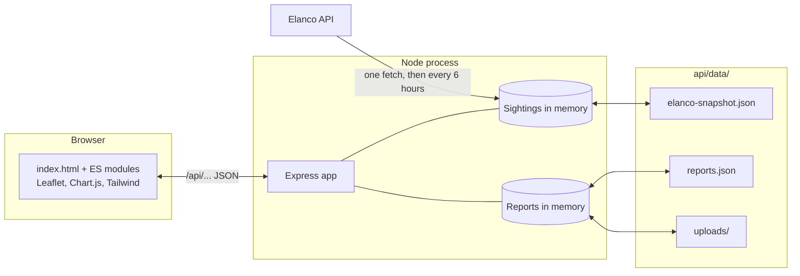
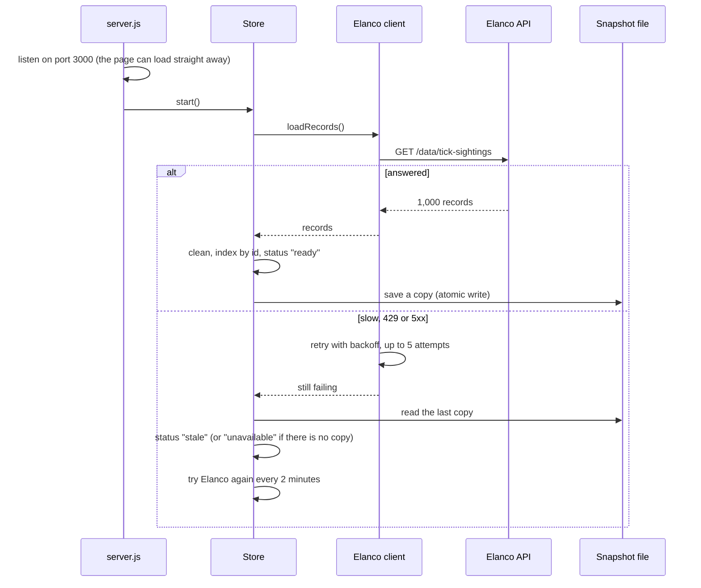
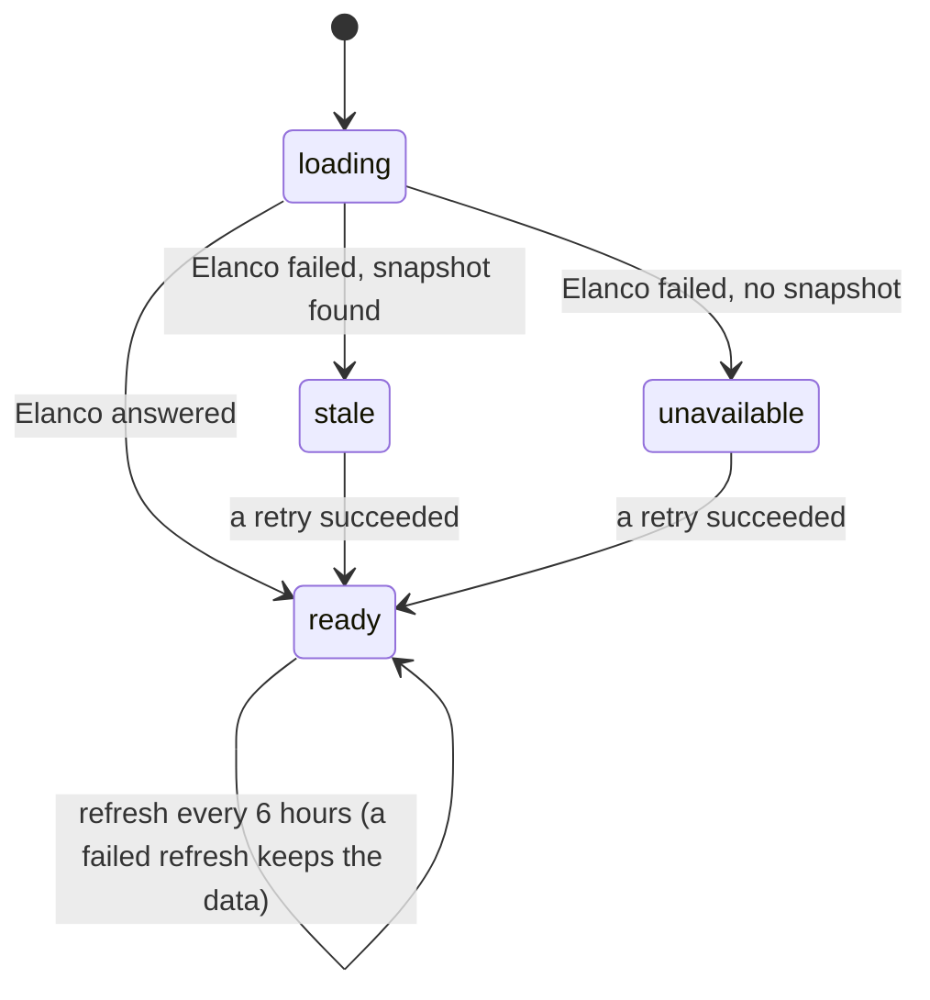

# Architecture

How Tick Tracker is put together, why it is built this way, and what would change with more time.
The [README](../README.md) covers the features, how to run it and the severity rule; this document
covers the structure behind them.

## Contents

- [The shape of it](#the-shape-of-it)
- [Backend layers](#backend-layers)
- [Frontend modules](#frontend-modules)
- [Data flow](#data-flow)
- [The data store's states](#the-data-stores-states)
- [Decisions and alternatives](#decisions-and-alternatives)
- [Error handling, layer by layer](#error-handling-layer-by-layer)
- [Performance and scale](#performance-and-scale)
- [Testing](#testing)
- [Accessibility](#accessibility)
- [Known limits](#known-limits)
- [With more time](#with-more-time)

## The shape of it

One Node process does everything. The `api` folder is an Express server; the `web` folder is a
static page that the same server sends to the browser. The page only ever talks to this server, and
only the server talks to Elanco.

## Backend layers

Each folder under `api/src` has one job. Dependencies point one way: routes call the domain code,
and the domain code calls the library code. Nothing in `analysis/` knows about HTTP, and no route
does any arithmetic of its own.

| Folder            | Job                                                                                  | Knows about HTTP? |
| ----------------- | ------------------------------------------------------------------------------------ | ----------------- |
| `server.js`       | Reads the settings, builds each piece, wires them together, starts listening         | Yes               |
| `src/app.js`      | Builds the Express app from the pieces it is given                                   | Yes               |
| `src/routes/`     | Reads and checks the query, calls the analysis functions, shapes the JSON            | Yes               |
| `src/middleware/` | Security headers, "data not ready" 503s, the rate limit, 404s, the one error handler | Yes               |
| `src/elanco/`     | Fetches Elanco's records, with a timeout, retries and backoff                        | Only as a client  |
| `src/sightings/`  | Cleans the records and keeps them in memory, with a snapshot on disk                 | No                |
| `src/analysis/`   | Filters, severity, per-city/region/species summaries, trends, seasons, pagination    | No                |
| `src/reports/`    | Checks reports and photos, and stores them in a JSON file                            | No                |
| `src/lib/`        | Dates, retry, name matching, safe JSON files, grouping and counting                  | No                |
| `src/reference/`  | The 14 cities with coordinates and regions, and the 5 species                        | No                |
| `src/config.js`   | Reads the environment variables and rejects bad values at start-up                   | No                |
| `src/errors.js`   | `HttpError` and helpers for 404 and 422, so every error has the same JSON shape      | Only the shape    |

Two habits run through the backend:

- **The analysis functions are pure.** Given the same sightings and filters, they return the same
  answer. They read no files, make no requests, and never look at the clock: the reference date, or
  "now", is always passed in. That is what makes them quick to test with a small fixture.
- **Pieces are handed what they need.** `createApp`, `createSightingStore` and
  `createReportRepository` take their collaborators as arguments (this is called dependency
  injection). The real server passes the real Elanco loader and the real data folder; the tests pass
  a fake loader that fails twice and then succeeds, or a temporary folder, without changing any
  code.

## Frontend modules

The page is one HTML file and a set of ES modules that the browser loads directly, with no framework
and no build step. Each folder is one part of the page.

| Module                   | Job                                                                                       |
| ------------------------ | ----------------------------------------------------------------------------------------- |
| `main.js`                | Start-up: asks the server what data it has, builds each part, keeps checking until ready  |
| `api.js`                 | The only code that calls the server; turns every failure into a message fit to show       |
| `state.js`               | Two small stores, the filters and the chosen city, mirrored in the address bar            |
| `map/`                   | The Leaflet map, its markers and legend, and the view that loads the map's data           |
| `cities/`                | The city list beside the map and the city detail panel with its timeline                  |
| `filters/`               | The filter form: dates, quick ranges, species, severity                                   |
| `insights/`, `seasonal/` | The trend, per-region and seasonal charts                                                 |
| `guide/`, `content/`     | The species guide and the hand-written notes about each species                           |
| `report/`                | The report form: checks, messages, photo preparation, "use my location", sending          |
| `about/`                 | The severity explanation and the data-quality report                                      |
| `charts/`                | Chart.js defaults and a chart panel with loading, empty, error and table views            |
| `ui/`                    | The shared loading, empty and error states, the data banner, navigation, headline numbers |
| `dom.js`, `format.js`    | Building elements safely, and formatting dates and numbers for UK readers                 |

When a filter changes, `filters/filterPanel.js` updates `filtersStore`. The map and the trend and region
charts are subscribed to it, so each one reloads its own data. Each view runs its requests through
`createLatestRequest` (in `ui/status.js`), which cancels the previous request when a new one starts,
so a slow, out-of-date answer can never overwrite a newer one.

## Data flow

### 1. Start-up

### 2. A filtered request

Take `GET /api/insights/locations?from=2024-01-01&species=marsh%20tick`, which the map sends when
someone picks the marsh tick and 2024 onwards.

1. **`securityHeaders`** adds the Content Security Policy and other headers.
2. **`requireData`** answers 503 if there is no data yet.
3. **`readQuery`** checks the options. An option it does not know (such as `spieces`) is an error.
   `parseSightingFilters` reads `from` as midnight UK time on 1 January 2024, and matches
   `marsh tick` to `Marsh tick` ignoring case. A name it cannot match comes back as a 422 with a
   "Did you mean…?" suggestion. Every problem is collected, so one response lists them all.
4. **`selectSightings`** keeps the sightings in the date range and species, rates the severity of
   all 14 cities on those, and only then applies the city and severity filters, so choosing one city
   never changes how it is rated.
5. **`summariseLocations`** builds one summary per city: totals, species mix, latest sighting,
   recent activity and severity.
6. The route sends the summaries, the reference date and the filters it understood, in canonical
   form, so the page can show "Marsh tick" even though it sent "marsh tick".

### 3. A report

1. In the browser, `report/validation.js` checks the form against the same rules the server uses
   (sent by `/api/meta`). Errors stop sending; warnings, such as a sighting over a year old, do not.
2. `report/photo.js` redraws the photo on a canvas and saves it as a JPEG at most 1,600 pixels
   on its longest side. This shrinks it and drops hidden details such as the GPS position.
3. The form is sent as `multipart/form-data`.
4. On the server, the **rate limit** allows 10 reports per visitor every 15 minutes.
5. **multer** reads the form into memory, stopping any photo over 5 MB while it is still arriving.
6. **`validateReport`** checks the text fields again, because anything can be sent to an API
   directly. **`checkPhoto`** decides the photo's type from its first bytes and reads its size from
   its header.
7. **`findSimilarReport`** looks for the same species, city and day, which becomes a warning, not
   an error, since it could be a second tick.
8. **The repository** writes the photo under a random name, then the updated JSON file. Writes wait
   in a queue, one at a time, and each is atomic (written to a temporary file, then renamed over the
   old one), so a crash cannot leave half a file. If the JSON write fails, the photo is deleted.
9. The API answers **201 Created** with the report, its address and any warnings. The page shows the
   success message and refreshes the city panel's community reports.

## The data store's states

| State         | Data endpoints answer                     | The page shows                                               |
| ------------- | ----------------------------------------- | ------------------------------------------------------------ |
| `loading`     | 503 `DATA_LOADING`, `Retry-After: 5`      | "Loading tick data from Elanco…", checks again every 3 s     |
| `ready`       | 200                                       | Everything                                                   |
| `stale`       | 200, from the snapshot                    | Everything, with "Showing saved data" and when it was saved  |
| `unavailable` | 503 `DATA_UNAVAILABLE`, `Retry-After: 60` | What is wrong, keeps checking every 30 s, fills in by itself |

`/api/health` and `/api/meta` answer in every state, so the page can always build its filters and
the report form. The report endpoints do not depend on Elanco at all.

A feed with nothing usable in it (an empty list, or every record rejected) counts as a failure. It is
far more likely to be a breaking change on Elanco's side than real news, so it never replaces good
data.

## Decisions and alternatives

### Data

- **Fetch once, keep it in memory.** The 1,000 records are about 150 KB of JSON, and Elanco rate-limits
  at about 30 rapid calls. Answering from memory takes a millisecond and cannot be rate limited.
  _Instead of_ passing each request on to Elanco's filtered endpoints, which would be slow, would
  hit the rate limit and would inherit Elanco's silent `[]` for a wrongly cased city.
- **Keep a snapshot on disk.** If Elanco is down when the server starts, the last good copy is
  served and clearly labelled. _Instead of_ an empty page whenever Elanco is unavailable.
- **Clean on the server, in one place.** One set of rules, tested once, and the page can trust what
  it receives. _Instead of_ every client cleaning for itself.
- **Fix what is unambiguous, reject what would need a guess.** Letter case and a missing Latin name
  are safe to fix; `01/05/2024` or a misspelt city are not. A wrong correction is worse than a
  missing record, and every decision is counted in the data-quality report. _Instead of_ keeping
  everything, or dropping anything unusual without saying so.
- **Hard-coded city coordinates.** A table of 14 cities cannot fail, costs nothing and is never rate
  limited. _Instead of_ geocoding at runtime, which adds a network dependency, its own rate limits,
  and ambiguity (there is more than one Newcastle in the UK).
- **Times kept as UK wall-clock times.** Elanco's timestamps have no timezone. Reading them as UTC or
  as the server's local time would shift sightings by an hour in summer, sometimes into another day
  or month, and give different answers on different machines. They are stored in a `Date`'s UTC
  fields and never converted. _Instead of_ a date library, which this small set of operations does
  not need.

### Analysis

- **Severity is recency-weighted and compared with the median city.** The README explains the rule
  and the alternatives (raw count, recency only). Comparing with the median means the map never
  invents a difference that is not in the data.
- **Severity is rated before the city and severity filters are applied.** Otherwise a city shown on
  its own would be compared only with itself and would always come out medium.
- **Recency is measured from the end of the data, not today.** Elanco's data ends in December 2024,
  so measured from today every city would score close to zero.
- **Trends include empty periods as zeros and stop where the data stops.** Leaving out empty
  periods would let a line chart join the dots across a quiet spell; zeros after the last sighting
  would look like activity stopping when the data simply ends.

### API

- **Unknown names and options are errors, with suggestions.** A silent empty list looks exactly like
  "no sightings", and a silently ignored option returns unfiltered data. _Instead of_ copying
  Elanco's behaviour.
- **One error shape everywhere:** `{ "error": { "code", "message", "details" } }`. `code` is for
  programs and `message` is for people. Unexpected errors become a generic 500, and the details go
  to the server log, never to the browser.
- **Aggregation happens on the server.** The page asks for exactly the summary it is about to show.
  _Instead of_ sending all the records to every browser and repeating the maths there.
- **Page sizes are capped at 100 and trends at 1,000 points**, so no single request can ask for
  everything at once, however large the data grows.

### Reports

- **A JSON file, not a database.** The brief asks for one, there is nothing to install, and the
  queue and atomic writes make it safe for one server process. A database is the first item under
  [with more time](#with-more-time).
- **Photos are checked by their bytes and held in memory until every check has passed.** A file
  name and a claimed type are both just text the sender chose. Holding the photo in memory means a
  rejected report never leaves a file behind. Only JPEG and PNG are accepted, so an SVG, which can
  contain scripts, can never be stored.
- **Community reports are shown but never counted in severity.** They are unverified, and a handful
  of fake reports must not be able to turn a city red.

### Frontend

- **No build step.** The browser loads the modules as they are written, which keeps every line
  explainable and debuggable in the browser. _Instead of_ React or Next.js, which the brief rules
  out for this task.
- **Elements are built with `h()` and text nodes, never `innerHTML`.** A report's notes can never
  become HTML on someone else's screen, because the code never turns text into HTML.
- **The page and the API share one origin**, so there are no CORS rules, and one `npm start` runs
  everything.
- **The filters and the chosen city live in the address bar**, so "Share" can share a link that
  reopens exactly the same view.

## Error handling, layer by layer

Each layer deals with the failures it understands and passes the rest on in a form the next layer
can use.

1. **Elanco client.** Every failure becomes an `ElancoApiError` that says whether trying again could
   help: timeouts, network errors, 429 and 5xx can; a 404 or a body that is not a list cannot.
2. **Retry.** Waits up to 1 s, then 2 s, 4 s and 8 s between attempts. Half of each wait is random
   (jitter), so many servers restarting together do not all retry in the same instant. A
   `Retry-After` header sets the minimum wait.
3. **Store.** Falls back to the snapshot, keeps current data when a refresh fails, and refuses a feed
   with nothing usable in it.
4. **Cleaning.** Removes or fixes broken records one at a time, so one bad record never sinks the
   rest, and counts every decision.
5. **Routes.** `readQuery` collects every problem with a request into one 422 response.
6. **`requireData`.** 503 with `Retry-After` until there is data to serve.
7. **Error handler.** One JSON shape; anything unexpected becomes a logged, generic 500.
8. **`api.js` in the page.** Network failures, timeouts (15 s), unreadable responses and server
   errors each become an `ApiError` with a message fit to show.
9. **Each view.** Shows loading, empty or error states with a "Try again" button, and charts fall
   back to a data table if Chart.js fails to load.
10. **`main.js`.** Keeps checking the server while data is loading or unavailable, so the page
    recovers without a reload.

## Performance and scale

Measured on the development container with synthetic records:

| Records | Cleaning (once, at start-up) | Map summary per request | Weekly trend per request | Process memory |
| ------- | ---------------------------- | ----------------------- | ------------------------ | -------------- |
| 1,000   | 4 ms                         | 0.6 ms                  | 1.5 ms                   | ~14 MB         |
| 100,000 | 0.5 s                        | 55 ms                   | 78 ms                    | ~124 MB        |

So the in-memory approach is comfortable well past today's 1,000 records. Somewhere beyond 100,000,
scanning every sighting on every request starts to cost real time, and the next steps would be:

- a database with indexes on date, city and species, so a query reads only matching rows;
- aggregates computed once when the data changes, not on every request;
- HTTP caching (an `ETag` that changes when the data does), so browsers stop asking for answers they
  already have;
- fetching Elanco's data page by page if the feed ever became paginated.

## Testing

- **The pure logic is tested directly** with small fixtures: `messy-sightings.json` has 33
  deliberately broken records, each with a note saying what is wrong with it, and
  `sample-sightings.json` has 24 tidy ones with known answers.
- **Every endpoint is tested over real HTTP** against a server started on a random port, with a fake
  store in whatever state the test needs (`api/test/support/testApp.js`).
- **The Elanco client and retry are tested with a fake `fetch`, a fake clock and fake randomness**,
  so tests of timeouts and backoff are instant and give the same result every time.
- **The page's own logic** (form checks, link sanitising, UK time, marker sizing, chart captions) is
  tested with the same test runner, as `.mjs` files.
- **Not automated:** the page in a real browser. It was checked by hand and with scripted Playwright
  runs and axe-core scans during development, but those scripts are not in the repository yet.

## Accessibility

The page uses plain semantic HTML first (real buttons, labels, headings, lists and tables), and ARIA
only where HTML has no equivalent: `aria-live` regions for status messages, `aria-describedby` and
`aria-invalid` to tie form messages to their fields, `aria-current` for the chosen city and
`aria-busy` while a report is sending. Map markers are keyboard buttons with spoken descriptions,
focus moves into the city panel when it opens and back to where it came from when it closes, and
every chart has a written summary and a table view.

One known exception: on a phone, some markers overlap, because cities tens of kilometres apart sit a
few pixels apart at that scale. WCAG 2.5.8 (target size) allows this when an equivalent control
meets the size rule, and the city list directly below the map does exactly what the markers do,
with full-size targets.

## Known limits

- **One process only.** The rate limit, the reports and the sightings all live in that process's
  memory. Two copies behind a load balancer would each have their own rate limit, and since each
  rewrites `reports.json` from its own list, they would overwrite each other's reports.
- **Reports are anonymous and unmoderated.** They are marked unverified and kept out of severity,
  but nothing stops someone posting nonsense up to the rate limit.
- **Photo metadata is only removed in the browser.** Someone calling the API directly could upload
  a JPEG that still has its GPS details. The server checks the type and size but does not re-encode.
- **The Tailwind browser build is not meant for production.** It compiles styles in the browser on
  every page load. A build step would replace it with one small CSS file.
- **Severity is relative and the counts are small**, about five to seven sightings per city per year,
  so differences between cities are partly down to chance.

## With more time

In rough order of value:

1. **A database for reports**, such as PostgreSQL, with a moderation status (unverified, verified,
   rejected) and a small admin view to review them. Verified reports could then count towards
   severity.
2. **Server-side image processing**: re-encode every photo on the server to strip metadata whatever
   the client did, make thumbnails, and store files in object storage (Azure Blob Storage or Google
   Cloud Storage) instead of the server's disk.
3. **Continuous integration**: a GitHub Actions workflow that runs `npm run check` on every push, plus
   the Playwright and axe-core browser checks committed as end-to-end tests.
4. **Move to Elanco's stack**: TypeScript with Next.js, sharing one set of types between the API and
   the page, and one validation schema used by both the form and the server instead of two
   implementations of the same rules.
5. **Shared state for more than one server**: rate limits and caches in a shared store such as
   Redis, so the app can run as several instances on Azure or Google Cloud.
6. **A better severity model**: real seasonal baselines, adjustment for population, and an
   indication of uncertainty when a city has only a handful of sightings.
7. **Map clustering** on small screens, so overlapping markers combine into one target that expands
   when tapped.
8. **Production hosting**: a Dockerfile, HTTPS, structured logs with request ids, and alerts when
   Elanco fetches keep failing.
9. **Self-hosted, built assets**: Leaflet and Chart.js served from this server and Tailwind compiled
   to a static CSS file, so the page does not depend on public CDNs.
