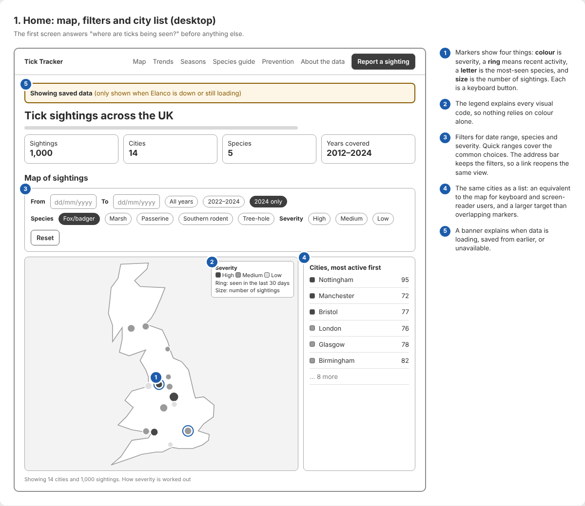
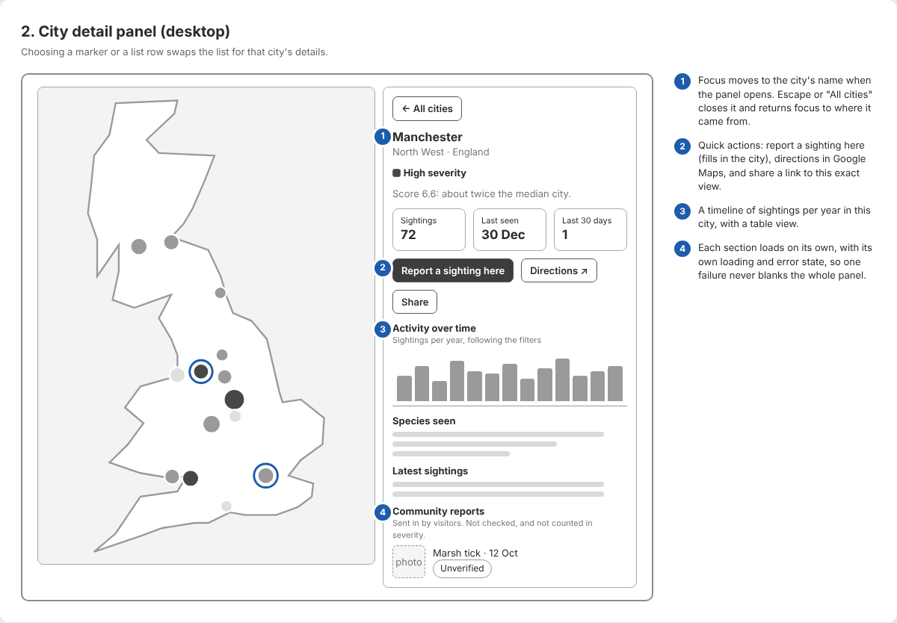
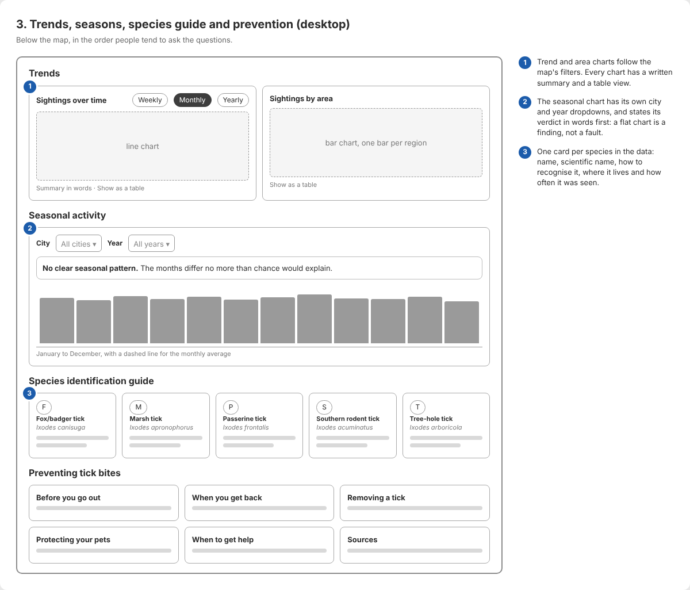
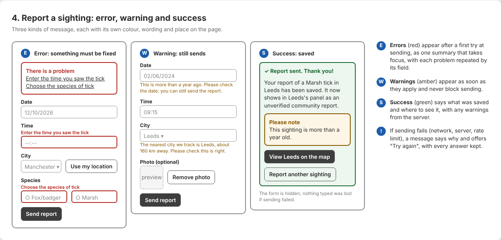
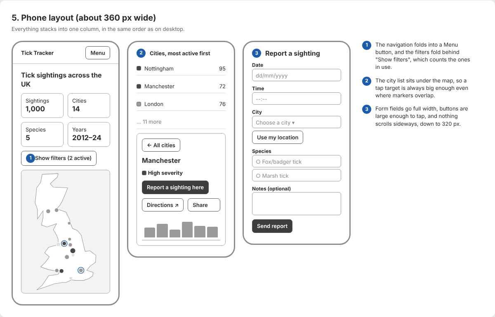
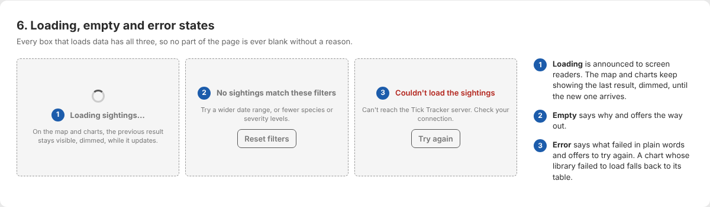

# Wireframes

Low-fidelity wireframes of Tick Tracker's main screens and states. They show layout, order and
behaviour, not final styling: they are greyscale on purpose, so the attention goes to structure,
and colour appears only where it carries meaning (the three report messages). The numbers in them
are placeholders, not real results.

The source is one HTML file, [`wireframes.html`](wireframes.html), which opens in any browser. The
images below are screenshots of it.

## Principles behind the layout

- **Answer the main question first.** The map, which shows where ticks are being seen, is the first
  thing below the headline numbers. Detail comes on demand, in the city panel.
- **One column on phones, in the same order.** Nothing is hidden on a small screen; the filters and
  the navigation fold away behind a button instead.
- **Every visual code has a text equivalent.** Severity is written in words as well as shown in
  colour, the map has a city list beside it, and every chart has a table.
- **Every box that loads data has a loading, an empty and an error state.**

## 1. Home: map, filters and city list

## 2. City detail panel

## 3. Trends, seasons, species guide and prevention

## 4. Report a sighting: error, warning and success

## 5. Phone layout

## 6. Loading, empty and error states

